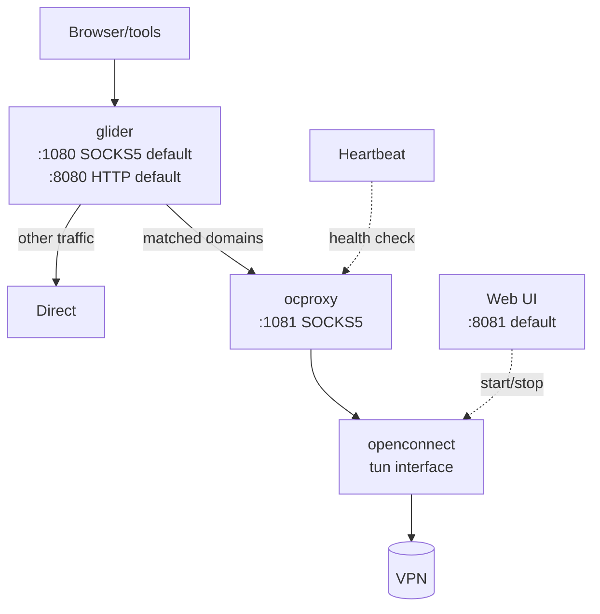

# OpenConnect Proxy Manager (OCPM)

OpenConnect Proxy Manager (OCPM) exposes an OpenConnect VPN connection through
HTTP and SOCKS5 proxies. It also provides a web UI for 2FA. OCPM uses
[OpenConnect](https://www.infradead.org/openconnect/index.html),
[ocproxy](https://github.com/cernekee/ocproxy), and
[glider](https://github.com/nadoo/glider).

## Motivation

Corporate VPNs are a common way to access internal resources, but routing all
traffic from a machine through the VPN is not always practical.

Even when it is practical, centrally managed split tunneling applies one set
of routes to everyone. Individual users and teams often need different rules.

OCPM lets you choose which domains use the VPN by configuring HTTP and SOCKS5
proxies. 

The trade-off is that applications need proxy configuration. Most browsers and
developer tools support HTTP or SOCKS5 proxies.

## How It Works



- **glider** listens on `:1080` for SOCKS5 and `:8080` for HTTP by default. It
  sends configured domains through the VPN and connects directly to everything
  else.
- **ocproxy** makes the VPN tunnel available as a SOCKS5 upstream for Glider.
- **web UI** listens on `:8081` by default and handles connection controls and
  MFA entry.
- **heartbeat** checks a configurable URL through the VPN and disconnects when
  repeated checks fail.

## Setup

```bash
cp .env.example .env
cp glider/rules.example.rule glider/rules.rule
# Edit both files with your credentials and domains.
```

### `.env`

```ini
OPENCONNECT_URL=https://vpn.example.com
OPENCONNECT_USER=your-username
OPENCONNECT_PASSWORD=your-password
OPENCONNECT_OPTIONS="--protocol=fortinet --servercert pin-sha256:... --disable-ipv6 --no-dtls"
# Optional: static MFA code (skips interactive prompt)
# OPENCONNECT_MFA_CODE=123456
HEARTBEAT_URL=http://internal.example.com
HEARTBEAT_INTERVAL=30
OCPM_SOCKS_PORT=1080
OCPM_HTTP_PORT=8080
OCPM_WEBUI_PORT=8081
# Auto-connect on startup (requires OPENCONNECT_USER + OPENCONNECT_PASSWORD)
# AUTO_CONNECT=true
```

### Configure Domain Routing

Edit `glider/rules.rule` to choose which domains use the VPN:

```ini
forward=socks5://127.0.0.1:1081
domain=example.com
```

All other traffic connects directly.

### Change Public Ports

OCPM uses port `1080` for SOCKS5, `8080` for HTTP, and `8081` for the web UI
by default. If any of these ports are already in use, change the corresponding
`OCPM_*_PORT` value in `.env`. Use the new values wherever this guide refers to
a default port.

## Run

```bash
docker compose up -d
```

## Usage

1. Open `http://localhost:8081`, or use your configured `OCPM_WEBUI_PORT`.
2. Click **Connect** to submit your credentials and begin the connection.
3. If prompted, enter the code and click **Submit 2FA Code**.
4. Once the VPN connects, the proxies are ready to use.

Configure your browser or tool to use:
- **SOCKS5**: `localhost:1080` (or your configured `OCPM_SOCKS_PORT`)
- **HTTP**: `localhost:8080` (or your configured `OCPM_HTTP_PORT`)

If `OPENCONNECT_USER` and `OPENCONNECT_PASSWORD` are not set in `.env`, the
web UI asks for them when you connect.

## Proxy Configuration Recipes

### I Want All Supported Application Traffic to Use OCPM

Configure your operating system to use OCPM as its HTTP and HTTPS proxy:

- Host: `localhost`
- Port: `8080` by default; use your configured `OCPM_HTTP_PORT`

Most applications that respect operating system proxy settings will use OCPM
without further configuration. If your operating system supports a SOCKS proxy,
use `localhost` on port `1080` by default, or the value of
`OCPM_SOCKS_PORT`. Applications without proxy support continue to connect
normally.

### I Only Want My Browser to Use OCPM

Configure the browser directly if you do not want to change system-wide proxy
settings.

#### Chromium-Based Browsers

Install [FoxyProxy](https://getfoxyproxy.org/), then add an HTTP proxy with
host `localhost` and port `8080` by default, or your configured
`OCPM_HTTP_PORT`. Set its rule or mode to proxy all URLs. Other applications
will keep their existing network settings.

#### Firefox

Open **Settings > General > Network Settings > Settings**, then choose
**Manual proxy configuration**. Set **HTTP Proxy** to `localhost` on port
`8080` by default, or your configured `OCPM_HTTP_PORT`, and enable **Also use
this proxy for HTTPS**.

To use SOCKS5 instead, set **SOCKS Host** to `localhost` on port `1080` by
default (or your configured `OCPM_SOCKS_PORT`) and select **SOCKS v5**.

### I Want Terminal Applications to Use OCPM

For tools that support HTTP proxies, export both uppercase and lowercase
variables:

```bash
export HTTP_PROXY=http://localhost:8080 HTTPS_PROXY=http://localhost:8080
export http_proxy="$HTTP_PROXY" https_proxy="$HTTPS_PROXY"
```

Replace `8080` with your configured `OCPM_HTTP_PORT` when using a non-default
port.

For tools that support SOCKS5, use `ALL_PROXY` instead:

```bash
export ALL_PROXY=socks5://localhost:1080 all_proxy="$ALL_PROXY"
```

Replace `1080` with your configured `OCPM_SOCKS_PORT` when using a non-default
port.

Add the configuration you use to your shell startup file to apply it to every
new terminal. To proxy one command at a time, create an alias instead:

```bash
alias ocpm-http='HTTP_PROXY=http://localhost:8080 HTTPS_PROXY=http://localhost:8080 http_proxy=http://localhost:8080 https_proxy=http://localhost:8080'
ocpm-http curl https://example.com
```

Choose either the HTTP variables or `ALL_PROXY` for a command. Setting both can
produce different results across tools.

### I Need Advanced Routing or Proxy Chaining

OCPM uses Glider for proxying. For custom routing rules and proxy chains, see
the [Glider documentation](https://github.com/nadoo/glider).
